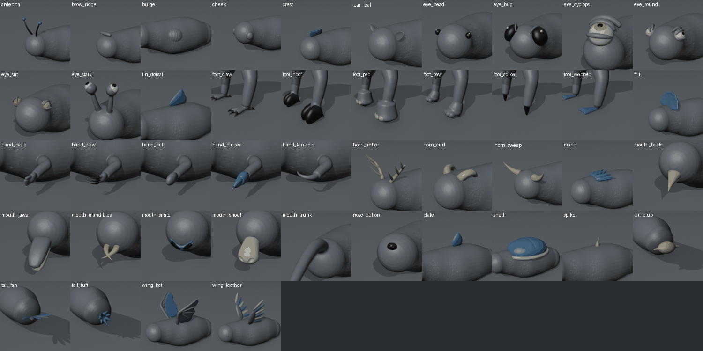

# PolyForge

A Spore-style creature builder that runs inside Blender. You assemble creatures from a library of sculpted parts on a bendable spine. The body, limbs and every skin part fuse into one sculpted surface. The creature rigs itself, animates procedurally, and exports to glTF/GLB, FBX, USD or OBJ, so any engine can use it. An AI loop builds a creature from a reference image within the library's style.




## Install

**Into Blender (the editor).** Requires Blender 4.2 or later with `scipy` available to Blender's Python.

```sh
<blender python> -m pip install scipy          # once
blender -b -P tools/install.py                  # installs the add-on + app template
blender --app-template PolyForge                # opens Blender as PolyForge
```

The editor lives in the 3D viewport sidebar, under the **PolyForge** tab.

**Headless (CLI, tests, AI loop).** Uses Blender as a Python module:

```sh
pip install bpy numpy scipy pillow
python3 pf.py --help
```

Any command also runs through a regular Blender: `blender -b -P pf.py -- <command>`.

## Using the editor

1. **Creature panel:** start a new creature or open an example. **Preview** rebuilds fast. **Sculpt** fuses the skin into one remeshed surface, which is what exports use.
2. **Parts panel.** Pick a shape and click anywhere on the body. A lateral drop creates a reflected twin. A drop within 12 degrees of the midline creates one centered instance. Tails are flexible joint chains and can be placed in the center.
3. **Selection panel.** Use **Isolate shape** to inspect one part or limb and edit its controls. Limbs have editable joint offsets and radii. Switch back to the creature to change instance scale, rotation, or placement. **Move to surface** picks a new location for the selected instance and its twin.
4. **Spine and paint.** Edit body rings or paint the assembled creature. A saved body attachment records two ring IDs and its fractional position between them. A distant edit to the spine preserves that binding. Widening its own strip carries the part outward.
5. **Animate & export panel:** bake idle, walk, run, roar, wave and hop, play them, and export GLB, FBX, USDZ or OBJ.

Every edit goes through the recipe, so Blender's undo covers it.

## How it works

- **Recipe:** a small JSON file holding the spine, limbs, parts, parameters and paint (`examples/*.json`). The editor and the AI change it through the same operations (`polyforge/ops.py`). `polyforge/recipe.py` clamps every value into the library's style ranges and enforces the placement rules.
- **Parts** (`polyforge/parts/`) are modelled in code with the sculpt kit (`polyforge/kit.py`): smooth PCHIP lofts and dense ovals, boolean carving, then a voxel remesh, smoothing and decimation per paint region (`polyforge/finish.py`). Thin plates use subdivision instead. Parameters are exact, because each part is rebuilt from its parameters and cached.
- **Builder** (`polyforge/builder.py`):
  - Sweeps the spine body and smooth limbs, places the parts, and voxel-remeshes the body, limbs and all skin-slot regions into one surface. Detail parts (eyes, horns, hooves, teeth) stay as separate finished meshes.
  - Builds the armature (spine chain, limb chains, part and jaw bones) and computes skin weights that blend across joints and where limbs meet the body.
  - Paints vertex colours (patterns, belly) and sets one material per paint slot.
- **Animation** (`polyforge/animator.py`):
  - Footprint gait planning for 0 to 8 or more legs, with FABRIK leg IK and a standing clearance chosen once for each walk.
  - Spine, tail and neck motion, plus part behaviours: eyes look and blink, jaws open, ears flop, wings flap.
  - Role-based actions (roar, wave, hop) that work on any creature.
  - `polyforge/baker.py` bakes each clip to an action on its own NLA track, so every exporter carries all clips.

## Commands

```sh
python3 pf.py review examples/bull.json --out out/bull-review
# Inspect the four images, then record your observations.
python3 pf.py review examples/bull.json --out out/bull-review --accept "$REVIEW_NOTE"
python3 pf.py build examples/bull.json --review out/bull-review/review.json --out out/bull --formats glb,fbx,usdz,blend
python3 pf.py render examples/bull.json --out out/bull --views front,side,threequarter [--engine cycles]
python3 pf.py animate examples/bull.json --review out/bull-review/review.json --clip walk --out out/bull_walk.mp4
python3 pf.py turntable examples/bull.json --review out/bull-review/review.json --out out/bull_turntable.mp4
python3 pf.py gallery examples/*.json --out out/gallery.png
python3 pf.py library --out out/parts       # each part as its own GLB, for engines that assemble parts themselves
python3 pf.py describe                       # family index, placement rules and operations
python3 pf.py describe --part horn_sweep     # controls and ranges for one family
python3 pf.py test [--fast]

# Image -> creature (needs ANTHROPIC_API_KEY)
pip install anthropic
python3 ai/forge.py photo.png --out runs/photo
python3 ai/benchmark.py                      # known-recipe numeric fit, no API key needed
python3 ai/benchmark.py --reference held-out.png --out runs/held-out
```

## Edit one shape

A shape file holds local geometry. A surface part uses `part` and `params`. A limb uses `segments`, `radii`, `tip` and `tip_params`; set `motion` to `tail` for a flexible chain. Fit belongs to the instance. Recipes may define local templates under `shapes` and instantiate one by name, as in `examples/spider.json`. Normalization expands them to independently editable instances.

```sh
python3 pf.py part examples/bull.json --uid fore --out out/fore
# Edit the local joint offsets or radii in out/fore/shape.json.
python3 pf.py part out/fore/shape.json --out out/fore-review
python3 pf.py attach examples/bull.json out/fore-review/shape.json --uid extra_leg --u .37 --theta -40 --out out/six-legged.json
```

Version 1 recipes migrate on load with their original placement. Version 2 saves the ring binding and a derived `u` for the slider. To slide an existing instance, use `set_limb` or `set_part` with a new `u`. To refit the creation floor after a limb edit, apply `{"op":"reground"}`.

Use `horn_sweep` for an unbranched horn and `ear_leaf` for round, pointed, long, or drooping ears. The bull and minotaur use both families. Existing recipes can still load the older specialized shapes. A branched antler and an articulated pincer retain their own construction.

The image loop defaults to Claude Haiku and accepts a model override through `POLYFORGE_MODEL`. It starts with a compact family index. For an identified feature, it requests that family's controls and critiques isolated views before the assembly fit. `--part-rounds` sets the local revision budget. The held-out benchmark writes first-pass validity, edit turns, renders and token usage. Review the rendered views against the input image to record artistic acceptance.

## Review assembly before animation

Shape the torso with the spine. Each leg owns its joint chain and foot, and each tail owns its flexible chain and attached ornaments. The leg solver poses the torso first, selects standing clearance from leg reach and stride, then solves the limbs. The legless gait retains spine undulation. Walk previews use a stationary camera with world travel.

In Blender, use **Render assembly review views** in **Animate & export**. Inspect the front, side, three-quarter and head views against the reference or intended anatomy, then accept the assembly. Check the eye relative to the jaw and horn roots, wing roots relative to the shoulders, foot placement and tail attachment wherever applicable. Recipe edits invalidate the previous acceptance.

For the CLI, generate and inspect the views, then record the observed result. Pass the resulting review file to build, animate or turntable commands. Commands also discover a review.json beside the input recipe. Static modeling and inspection remain available while review is pending.

```sh
python3 pf.py review examples/dragon.json --out out/dragon-review
python3 pf.py review examples/dragon.json --out out/dragon-review --accept "Eyes ahead of horn roots; both wings seated at shoulders"
python3 pf.py animate examples/dragon.json --review out/dragon-review/review.json --clip walk --out out/dragon-walk.mp4
```

## Verify the exported walk

```sh
python3 pf.py build examples/spider.json --review out/spider-review/review.json --out out/spider --formats glb --contacts
blender -b --python-exit-code 1 -P tools/tests/export_contact.py -- out/spider/spider.glb
```

The build report supplies stance timing and travel for the in-place clip. The Blender check locates rigidly weighted sole vertices in the imported mesh, measures their height and world-space drift during stance, and requires each foot to lift. Run the same commands with the bull and minotaur recipes. The regular test suite also checks the bull.

## Layout

| Path | What it is |
| --- | --- |
| `polyforge/` | The Blender add-on: kit, parts, recipe, placement, builder, animator, baker, export, render, UI, CLI, tests |
| `app_template/` | Starts Blender as PolyForge |
| `tools/install.py` | Installs the add-on and app template into a Blender install |
| `pf.py` | Command-line entry point |
| `ai/` | Image-to-recipe loop (Claude + numeric fitting), scoring, benchmark |
| `examples/` | Example recipes |
| `library/thumbs/` | Part thumbnails used by the editor palette |
