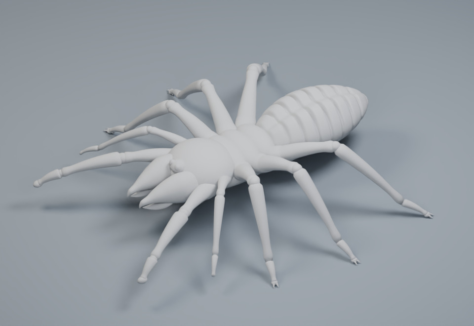
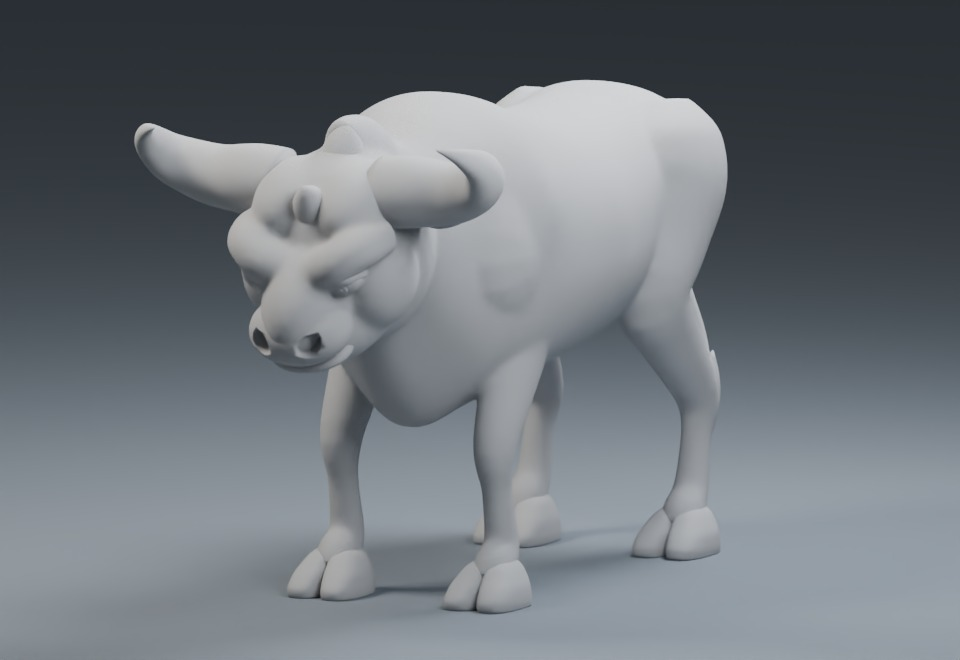

# PolyForge · Character studies

## Solifuge



[Neutral turntable](preview/arachnid-turntable.mp4) · [Walking clip](preview/arachnid-walk.mp4) · [Rigged GLB](godot/arachnid.glb) · [Recipe](models/arachnid.json)

The supplied dorsal-oblique photograph shows a solifuge with forward-facing paired chelicerae, long pedipalps and a visibly segmented abdomen. The abdomen occupies roughly half the length from jaw tip to rump in the image. The neutral model preserves this proportion and separates the front appendages so their functions read during motion. Surface heights, hidden joints and the mirrored far side are estimates. Model coordinates use Blender units, +Z up and −Y forward.

The three rear pairs support the body in a low, symmetric stance with flexed joints. The sensory first leg pair and pedipalps hover above the floor. The fixed and movable fingers of each chelicera have separate bones. The walk alternates tripods, solves each supporting leg to its foot target, and advances the body 1.30 units over two cycles. [Solifuge anatomy reference](https://ph.health.mil/resources/ento-arachnids-afghan-poster.pdf)

### Generate a creature from a recipe

A lightweight agent can select the solifuge preset and supply a few numeric controls. With Blender 4.3.2 (including NumPy and SciPy), Python 3 and FFmpeg on PATH, this command builds the mesh and rig, bakes idle and walk, reimports the GLB for contact checks, then writes the resolved recipe, GLB, neutral PNG, turntable and walking video to the output folder.

```sh
python tools/generate.py --preset solifuge --out review/solifuge
```

Run `python tools/generate.py --describe` to get the default recipe, role choices and numeric bounds as JSON without opening Blender. Use `--shape abdomen_width=1.12` to adjust a preset. Use `--recipe models/arachnid.json` in place of `--preset` to edit the assembly. The optional `--oidn /path/to/oidnDenoise` filters the rendered frames. The checked-in example uses the supplied photo as a human-interpreted reference. The automated pipeline begins with the preset or JSON.

| Recipe field | Effect |
| --- | --- |
| `shape` | Abdomen length, abdomen width and jaw width each accept 0.75–1.25. |
| `mounts[].id` | A unique identifier for the paired joint chains. |
| `role` | `foot` receives a contact pad, claws and foot-planting IK. `feeler` and `palp` use the same limb builder with a different taper, tip and hovering motion. |
| `socket_y` | Front-to-back position along the prosoma, from −1.05 to 0.18. The shared placement function reflects the complete part and joint chain. |
| `sweep`, `reach` | Angle from the lateral axis in degrees (−78 to 65) and horizontal reach in model units (1.4–2.7). Negative sweep points forward. |
| Mount order | Weight-bearing pairs alternate phase in recipe order. Each mirrored partner walks half a cycle later. |

To update only the studio asset, run `blender -b --python-exit-code 1 -P tools/build.py -- --recipe models/arachnid.json`. The studio exposes abdomen width, abdomen depth and jaw breadth as live blend shapes.

## Bull

An unarmored adult bull built from a fresh recipe. Its bovine head, swept horns, split hooves and tufted tail are the same catalog parts used by the minotaur. The `heavy_quadruped` body supplies a horizontal torso with paired shoulder and hip sockets. Each socket accepts one `ungulate_leg` part. The recipe selects the fore or hind profile and can set fullness from 0 to 1. A continuous surface connects brisket, belly and rump.



[Earlier foreleg shape comparison](preview/bull-forelegs.jpg) · [Neutral turntable](preview/bull-turntable.mp4) · [Side-view walk](preview/bull-walk.mp4) · [Rigged bull](godot/bull.glb) · [Bull recipe](models/bull.json)

At build time each socket constructs its leg and shared hoof once. The attachment mirrors the assembled geometry and joint positions across the body. An edit to the shoulder attachment updates both forelegs on rebuild. Each side gets its own bones in the 28-joint skeleton. During its walk the bull advances 2.08 model units over two strides. Each hoof bears weight for 66% of its cycle and lifts in turn. Both the idle and walk are baked into the GLB.

## Minotaur

A runnable Godot character study of the far-right minotaur in the supplied lineup. The model opens in a neutral stance, uses one matte gray material, and has a 24-joint skeleton.


[Earlier rear mane detail](preview/minotaur-mane.jpg) · [Earlier rear shape comparison](preview/minotaur-back.jpg) · [Step in place from behind](preview/minotaur-motion.mp4) · [Neutral turntable](preview/minotaur-turntable.mp4) · [Rigged 3D model](godot/minotaur.glb)

## Place one part and reuse it

The builder uses the attachment root to choose how many instances to place. A socket on the host’s X=0 plane emits one assembly. A lateral socket emits the authored assembly and its reflection, with corrected face winding and matching joint positions. The mesh can cross the midline freely. The same rule places horns, ears, eyes, limbs and their attached details on both characters. Sculpted locks within a mane and the two toes within a cloven hoof travel with their owning part.

Both recipes mount one tufted tail at the center of the pelvis. Its shaft blends across three bones and the tuft follows the tip. Idle and walk apply a delayed bend along the chain. This is baked animation. To try a pair, change the recipe’s `"socket_x": {"tail": 0.0}` to `"socket_x": {"tail": 0.20}` and rebuild. Both tails receive their own skin weights and animation. The same optional map accepts `horn`, `ear`, and `eye` in head-local units. Tail offsets use body-local units. Existing recipes can omit the map.

## Open the studio

Import `godot/project.godot` in Godot 4.3 and press **F6** with the studio scene open, or **F5** to launch the project. Choose **Minotaur**, **Bull** or **Solifuge** in the character menu. Drag the viewport to orbit, scroll to zoom, and use the shape sliders for the selected character. Select **Idle** for any character, **Walk forward** for the bull or solifuge, or **Step in place** for the minotaur. **Neutral** restores the original stance. **Save proportions** remembers the slider values for that character on that computer.

The minotaur GLB also opens independently in Blender or another glTF viewer. It carries the neutral mesh, shape controls, and baked idle and step-in-place clips (the latter uses the animation key `Walk`). The Godot studio stores edits locally. To bake a different base model for distribution, edit the JSON recipe and rebuild it.

## How this reference is fitted

The anatomical interpretation of the supplied image is in `models/reference.json` and `models/minotaur.json`. The fitting tool uses the annotated horn windows to detect the visible tips and outside contours, calibrates their size from eye height above the ground, and solves for the corresponding catalog horn width and rise. The source image stays local. The exposed muzzle, torso, arms, hooves, and tail are shaped in the procedural builder. Hidden anatomy is estimated. The bull uses an authored recipe. Image fitting currently supports the annotated minotaur horns.

With Python, NumPy, SciPy, and Pillow installed:

```sh
python tools/fit_reference.py path/to/lineup.png --output models/minotaur.json
```

## Generate the rig and previews

The generator was run with Blender 4.3.2, NumPy, and SciPy. The recipe selects the core parts and sets horn span and rise, shoulder width, chest depth, and muzzle length. The builder creates the anatomy, binds the skeleton, adds shape controls, and solves and bakes the gait. The minotaur’s two-second step cycle keeps each hoof fixed in world space for 60% of its cycle. Both feet briefly share the load as the pelvis shifts toward the next support. The ribs turn against the pelvis, followed by the arms, head and tail. The idle breath originates in the upper body.

```sh
blender -b --python-exit-code 1 -P tools/build.py
blender -b --python-exit-code 1 -P tools/build.py -- --recipe models/bull.json
blender -b --python-exit-code 1 -P tools/render.py -- godot/minotaur.glb review --clip still
```

For the editable Blender scene, pass `-- --review review` to the build script. Render accepts `--clip turn` or `--clip walk` for PNG sequences. The review uses independent videos for the neutral orbit and the stationary step. The step preview uses `--azimuth 146` to show how the back and hips deform under load. The full renderer defaults to 64 samples per minotaur motion frame and 36 per bull motion frame. The included motion previews use `--samples 10 --frame-step 2` with denoising, encoded at 12 fps for the walks and 9 fps for the turntables. The bull walk uses a fixed side camera. Supply `--oidn /path/to/oidnDenoise` to apply Open Image Denoise before the display transform. The preview images come from reimporting the exported GLB.

To check the imported sole contacts, run `godot --headless --editor --import --path godot`, then `godot --headless --path godot --script "$PWD/tools/tests/ground_contact.gd"` from the repository root. The check samples the soles through idle and both sides of the step, including between baked keyframes.

To verify centered and bilateral placement on rotated and translated sockets, run `blender -b --python-exit-code 1 -P tools/tests/paired_attachment.py`.

For the bull, run `godot --headless --path godot --script "$PWD/tools/tests/bull_walk.gd"`. This checks all four soles, forward displacement, shape controls and character switching. The Blender check `blender -b --python-exit-code 1 -P tools/tests/back_deformation.py -- godot/bull.glb` measures how the flank stretches across the walk.

To verify the exported tail hierarchy, skin weights and local motion in both clips, run
`blender -b --python-exit-code 1 -P tools/tests/tail_rig.py -- godot/bull.glb`.
Use the same command with the minotaur GLB, or add `--paired` for a lateral-tail build.

The design plan and research are in [PLAN.md](PLAN.md).
