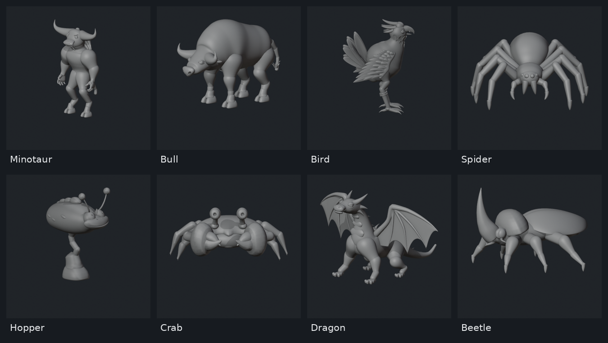

# Globberator

A Spore-style creature builder that runs inside Blender. You assemble creatures from a library of sculpted parts on a bendable spine. The body, limbs and every skin part fuse into one sculpted surface. The creature rigs itself, animates procedurally, and exports to glTF/GLB, FBX, USD or OBJ, so any engine can use it. An AI loop builds a creature from a reference image within the library's style.




The [example design studies](examples/references/README.md) document the fresh clay references and link each study to its recipe. The [hummingbird example](examples/hummingbird/README.md) includes the build scripts, clay preview, and visual review.

## Install

**Into Blender (the editor).** Requires Blender 4.2 or later with `scipy` available to Blender's Python.

```sh
<blender python> -m pip install scipy          # once
blender -b -P tools/install.py                  # installs the add-on + app template
blender --app-template Globberator                # opens Blender as Globberator
```

The editor lives in the 3D viewport sidebar, under the **Globberator** tab.

**Headless (CLI, tests, AI loop).** Uses Blender as a Python module:

```sh
pip install bpy numpy scipy pillow
python3 pf.py --help
```

Any command also runs through a regular Blender: `blender -b -P pf.py -- <command>`. Existing recipes and Blender files use the same data format.

## Using the editor

1. **Creature panel:** start a new creature or open an example. **Preview** rebuilds fast. **Sculpt** fuses the skin into one remeshed surface, which is what exports use. Spine edits keep the floor fixed so the legs don't jump. Leg edits re-find the floor automatically, and **Reground** re-finds it on demand.
2. **Parts panel.** Pick a shape and click a host surface. Research limbs place an articulated joint chain with its sculpt. Limb tips attach at the host limb's end, and sucker rows attach to a limb surface. Select the radial bell to change the body plan. Paired families place reflected twins. Families with flexible symmetry place one centered instance when dropped within 12 degrees of the midline.
3. **Selection panel.** Use **Isolate shape** to inspect one part or limb and edit its controls. Limbs have editable joint offsets and radii. Switch back to the creature to change instance scale, rotation, or placement. **Move to surface** picks a new location for the selected instance and its twin.
4. **Spine.** Edit body rings. A saved body attachment records two ring IDs and its fractional position between them. A distant edit to the spine preserves that binding. Widening its own strip carries the part outward.
5. **Animate & export panel:** bake idle, walk, run, roar, wave and hop, play them, and export GLB, FBX, USDZ or OBJ.

Every edit goes through the recipe, so Blender's undo covers it.

## How it works

- **Recipe:** a small JSON file holding the spine, limbs, parts and shape controls (`examples/*.json`). The editor and the AI change it through the same operations (`polyforge/ops.py`). `polyforge/recipe.py` clamps every value into the library's style ranges and enforces the placement rules.
- **Parts** (`polyforge/parts/`) are modelled in code with the sculpt kit (`polyforge/kit.py`): smooth PCHIP lofts and dense ovals, boolean carving, then a voxel remesh, smoothing and decimation per sculpt region (`polyforge/finish.py`). Thin plates use subdivision instead. Parameters are exact, because each part is rebuilt from its parameters and cached.
- **Builder** (`polyforge/builder.py`):
  - Sweeps the spine body and smooth limbs, places the parts, and voxel-remeshes the body, limbs and all skin-slot regions into one surface. Detail parts (eyes, horns, hooves, teeth) stay as separate finished meshes.
  - Builds the armature (spine chain, limb chains, part and jaw bones) and computes skin weights that blend across joints and where limbs meet the body.
  - Uses one neutral clay material for the body and all parts. Legacy recipe paint fields are ignored on load.
- **Animation** (`polyforge/animator.py`):
  - Footprint gait planning for 0 to 8 or more legs, with FABRIK leg IK and a standing clearance chosen once for each walk.
  - Spine, tail and neck motion, plus part behaviours: eyes look and blink, jaws open, ears flop, wings flap.
  - Role-based actions (roar, wave, hop) that work on any creature.
  - `polyforge/baker.py` bakes each clip to an action on its own NLA track, so every exporter carries all clips.

## Commands

For a reference-driven build, follow the [agent workflow](AGENTS.md) from target selection through independent review. Examples and library images show tool usage and part shapes. The workflow matches geometry and exports uniform clay assets for separate coloring in downstream tools.

### One-shot characters

For an upright humanoid, pass a single reference image and an output directory.

```sh
PF_BLENDER=blender python3 ai/forge.py reference.png --one-shot --out out/character
```

The one-shot command makes one structured classification request through the existing hosted classifier. It uses the `anthropic` package, `ANTHROPIC_API_KEY`, and the model selected by `GLOBBERATOR_MODEL`. A pipeline that already classifies the image can pass `--brief brief.json` and skip inference. See the [classification schema](polyforge/character_brief.py).

The original brief produces the humanoid preset. For the experimental general path, use `--one-shot --general` or supply a version 2 brief. It records the anatomical body plan, relative proportions, locomotion profile, and desired features by host, function, and silhouette. The compiler reports unresolved features and produces Blender actions, a .blend, and an animated GLB. Root travel is in the clip report.

The compiler handles proportions, paired limbs, face, hair, footwear, and rigging. It writes a neutral-clay `character.glb` with skin weights and an accompanying `character.motion.json` with role bindings and reusable pose rules. The GLB contains no baked clips. The export also includes `recipe.json`, `preview.png`, the classification, and `report.json`. The one-shot preset supports upright humanoids.

Changing the head fraction recomputes the body proportions and attachment positions. The recipe `scale` controls resize joint chains and attached hands or footwear together. The Blender builder regenerates and weights the mesh, and the runtime controller measures the resulting skeleton on bind.

For a generic skin limb, `root_blend` controls how the root loft enters the body and how strongly the final sculpt smooths the join. Values range from 0 to 1. The minotaur uses it on shoulders and hips without changing joint positions as the value varies.

### Runtime motion in Godot

Export any creature recipe with `pf.py build RECIPE --runtime-motion --formats glb --out DIR` to get a rigged GLB and its motion JSON. The editable `poses` section describes ground-relative steps, lift and stride scaled by leg length, a limb-relative reach pose, and spring settings. The `limbs` and `parts` sections bind named joints to roles for the generated body.

Add [creature_motion.gd](godot/creature_motion.gd) below the imported `Skeleton3D` and call `configure()` with the parsed motion JSON. Call `drive("walk", forward_speed)` or `drive("run", forward_speed)` with the speed of the actor that owns movement. The skeleton modifier groups legs by length, holds stance targets in world space, and solves the current chains. Set `ground_at` to a callable that returns ground height at a world position for uneven terrain. Call `reach(limb_id, world_target)` for a grasper or `set_part_amount(part_id, amount)` for a hinged part. Uncontrolled chains receive spring motion.

Blender handles mesh generation, assembly, and skin weighting at build time. Godot loads the finished asset and evaluates motion from its bindings. Call `configure()` again if you replace the imported asset with a rebuilt version. The editor's explicit baked export is still available for compatible playback tools.

Arm swing follows the nearest same-side leg's step phase when a leg is available. The solver uses a rigid span for one segment, a single bend for two segments, and the authored bend directions to guide longer chains.

Run the headless runtime checks on freshly generated fixtures.

```sh
blender -b --python-exit-code 1 -P tools/tests/make_runtime_fixtures.py -- out/runtime-fixtures
godot --headless --path tools/tests --script runtime_motion.gd -- "$PWD/out/runtime-fixtures"
```

### Recipe and library commands

```sh
mkdir -p out/asset
python3 pf.py new --name "My creature" --out out/asset/recipe.json
python3 pf.py search "human hand"            # active families, attachment types and thumbnails
python3 pf.py review examples/bull.json --out out/bull-review
# Inspect the four images, then record your observations.
python3 pf.py review examples/bull.json --out out/bull-review --accept "$REVIEW_NOTE"
python3 pf.py build examples/bull.json --review out/bull-review/review.json --out out/bull --formats glb,fbx,usdz,blend
python3 pf.py render examples/bull.json --out out/bull --views front,side,threequarter [--engine cycles]
python3 pf.py animate examples/bull.json --review out/bull-review/review.json --clip walk --out out/bull_walk.mp4
python3 pf.py turntable examples/bull.json --review out/bull-review/review.json --out out/bull_turntable.mp4
python3 pf.py gallery examples/*.json --out out/gallery.png
python3 pf.py library --out out/parts       # each part as its own GLB, for engines that assemble parts themselves
python3 pf.py describe                       # family index, placement rules and operations
python3 pf.py describe --part horn_sweep     # controls and ranges for one family
python3 pf.py surface RECIPE X Y Z          # estimate u/theta for a body landmark
python3 pf.py test [--fast]

# Image -> creature (needs ANTHROPIC_API_KEY)
pip install anthropic
python3 ai/forge.py photo.png --out runs/photo
python3 ai/forge.py photo.png --out runs/x --init examples/bull.json --no-llm --accept "checked the review views"   # numeric fit only; --accept lets it export
python3 ai/benchmark.py                      # known-recipe numeric fit, no API key needed
python3 ai/benchmark.py --reference held-out.png --out runs/held-out
```

## Edit one shape

A shape file holds local geometry. A surface part uses `part` and `params`. A limb uses `segments`, `radii`, `tip` and `tip_params`; set `motion` to `tail` for a flexible chain. Fit belongs to the instance. Recipes may define local templates under `shapes` and instantiate one by name. Normalization expands them to independently editable instances.

```sh
python3 pf.py part examples/bull.json --uid fore --out out/fore
# Edit the local joint offsets or radii in out/fore/shape.json.
python3 pf.py part out/fore/shape.json --out out/fore-review
python3 pf.py attach examples/bull.json out/fore-review/shape.json --uid extra_leg --u .37 --theta -40 --out out/six-legged.json
```

Version 1 recipes migrate on load with their original placement. Version 2 saves the ring binding and a derived `u` for the slider. To slide an existing instance, use `set_limb` or `set_part` with a new `u`. To refit the creation floor after a limb edit, apply `{"op":"reground"}`.

Use `horn_sweep` for unbranched horns and `ear_pinna` for adjustable ear profiles. Existing bull and minotaur recipes continue to load their original horn and ear IDs. Branched antlers and articulated pincers have dedicated models.

## Research part library

The [coverage plan](research/coverage_plan.json) prioritizes gaps in the existing part library. Pick a useful reference animal for each gap, model the specific part, and test it on a local Blender attachment fixture. Run `python3 research/validate.py --check` to validate the research queue and evidence without modifying the index. Approximately 300 qualified families is a planning target. See the [research workflow](research/README.md) for the evidence and qualification process.

The 13 species files contain 119 recorded structures. The library groups 105 usable source records into 54 model families. Round and slit pupils share the camera-eye family. Paired structures use a single authored model, and repeated anatomy such as shark median fins uses shape controls. The same octopus arm record supplies two independent models, a tapered limb and its sucker rows. The 14 exclusions include internal structures, texture features, and regions handled by the existing spine body.

The [research specification](research/part_library.json) records the sources, measured dimensions, and shape controls. Each research family has a [clay reference](library/references) named by part ID. The palette thumbnails render the procedural models. The complementary group retains 16 earlier shapes for gaps such as cloven hooves, horns, bat wings, turtle shells, and trunks. Older recipes still resolve their original part IDs.

Use `pf.py search` to find active families by plain-language terms, then `pf.py describe --part` for exact controls. Search returns an empty list when no family matches all terms. Use the result's `shape` object with `pf.py part` to inspect an individual candidate.

For a simple rounded boot, `pf.py search "boot"` supplies `{"part":"foot_hoof","params":{"split":0}}`. On a limb, set `tip_params.split` or use **Groove width** in Blender's Selection panel. Zero closes the toe and sole. Higher values widen the groove, with `0.6` as the cloven default.

The sculpts use the recipe frame with +Y up, +Z forward, and the local origin at the mount. A paired model is authored on the +X side. The clay views show a neutral pose with stylized volume for surfaces hidden from the research camera.

The muzzle, nose pad, camera-eye lids, padded paw, grasping foot, jaw base and feathered wing base use authored subdivision cages. The jaw retains its procedural tooth rows and hinge. The wing retains folding and feather controls. In the editor, drop a nose pad on the tip of a muzzle to seat it in the muzzle's frame. Recipes can specify the same host with `"on": "<muzzle uid>"`.

To inspect an individual model, pass a small JSON shape such as `{"part": "eye_camera", "params": {"slit": 0.3}}` to `pf.py part`. To export its default standalone GLB, use `pf.py library --part eye_camera --out out/parts`. Research limbs also accept an editable family payload such as `{"family": "leg_jumping", "params": {"fold": 0.8}}`.

The image loop defaults to Claude Haiku and accepts a model override through `GLOBBERATOR_MODEL`. It starts with a compact family index. For an identified feature, it requests that family's controls and critiques isolated views before the assembly fit. `--part-rounds` sets the local revision budget. The held-out benchmark writes first-pass validity, edit turns, renders and token usage. Review the rendered views against the input image to record artistic acceptance.

## Review assembly before animation

### Blender metaball pilots

Set `"construction": "metaball"` on a recipe to use the continuous soft-skin builder. It builds a closed surface over the spine and soft limb chains. Hooves, flukes, wing membranes, and other authored details retain their own geometry and mounts. The same pivots drive skin weights and Blender poses. Existing recipes retain their selected construction mode.

Use a recipe's biological locomotion profile to request the appropriate motion. The new profiles include `axial_vertical`, `axial_lateral`, `paddling`, `flight`, and `crawl`. The baker derives the available clips from the rig. Swim, powered flight, and glide use Blender actions. The Blender exporter writes editable .blend files and animated GLBs. The Godot bindings path remains available for existing workflows.

```sh
blender -b -t 2 --python-exit-code 1 -P tools/tests/metaball_pilots.py -- out/metaball-pilots minotaur dolphin bat --renders
blender -b --python-exit-code 1 -P tools/tests/blender_locomotion.py
blender -b --python-exit-code 1 -P tools/tests/test_asset_validation.py
python3 -m polyforge.asset_validation held-out.json --out out/fidelity.json
```

The first command bakes and reimports each pilot using both construction modes, then writes paired pose section measurements. `--renders` adds eight rest views and labeled pose samples. See the [water and air pilot references](examples/pilots/README.md) for their anatomical measurements. The fidelity report takes reference and rendered masks, independently marked landmarks, and a visual review record. Missing evidence stays pending. The proposed new default depends on passing the baseline, motion, and likeness gates.

To aggregate a frozen, annotated reference set, run `python3 ai/benchmark.py --held-out index.json --out out/held-out`. The index maps case names to reference, candidate, and incumbent views and their review evidence. A case can declare `required_views`, a separate `validation_report`, and `accepted_families` keyed by feature ID. The aggregate reports rig validity, likeness, joint first-pass results, and top-five retrieval separately.

Set `"mirror": false` on an attachment or limb to keep it on its authored side. An optional limb `bend_limits` list gives a degree range `[min, max]` or `null` for each internal joint, counted outward from the host. A zero-degree angle is straight. Blender preserves the limit when it has to shorten a reach or step target.

New recipes and the one-shot character compiler use solid construction. To apply it to an existing recipe, set the top-level `"construction": "solid"`. The rounded torso follows the body pivot. Tapered limb segments overlap around the joint centers, and each segment or attached part follows a single bone. Keep the older construction for characters whose body itself needs to undulate along the spine, such as the serpent.

Shape the torso with the spine. Each leg owns its joint chain and foot, and each tail owns its flexible chain and attached ornaments. The leg solver poses the torso first, selects standing clearance from leg reach and stride, then solves the limbs. The legless gait retains spine undulation. Walk previews use a stationary camera with world travel.

For agent-built assets, the modeling agent calls a fresh subagent to inspect the reference and renders independently. The [agent review instructions](AGENTS.md) cover what to share, which views to render, and how to verify fixes.

In Blender, use **Render assembly review views** in **Animate & export**. Inspect the front, side, three-quarter and head views against the reference or intended anatomy, then accept the assembly. Check the eye relative to the jaw and horn roots, wing roots relative to the shoulders, foot placement and tail attachment wherever applicable. Recipe edits invalidate the previous acceptance.

For the CLI, generate and inspect the views, then record the observed result. Pass the resulting review file to build, animate or turntable commands. Commands also discover a review.json beside the input recipe. Static modeling and inspection remain available while review is pending.

```sh
python3 pf.py review examples/dragon.json --out out/dragon-review
python3 pf.py review examples/dragon.json --out out/dragon-review --accept "Eyes ahead of horn roots; both wings seated at shoulders"
python3 pf.py animate examples/dragon.json --review out/dragon-review/review.json --clip walk --out out/dragon-walk.mp4
```

## Verify the exported walk

```sh
python3 pf.py build examples/spider.json --review out/spider-review/review.json --out out/spider --formats glb --contacts
blender -b --python-exit-code 1 -P tools/tests/export_contact.py -- out/spider/spider.glb
```

The build report supplies stance timing and travel for the in-place clip. The Blender check locates rigidly weighted sole vertices in the imported mesh, measures their height and world-space drift during stance, and requires each foot to lift. Run the same commands with the bull and minotaur recipes. The regular test suite also checks the bull.

## Layout

| Path | What it is |
| --- | --- |
| `polyforge/` | The Blender add-on: kit, parts, recipe, placement, builder, animator, baker, export, render, UI, CLI, tests |
| `app_template/` | Starts Blender as Globberator |
| `tools/install.py` | Installs the add-on and app template into a Blender install |
| `pf.py` | Command-line entry point |
| `ai/` | Image-to-recipe loop (Claude + numeric fitting), scoring, benchmark |
| `examples/` | Example recipes |
| `library/thumbs/` | Part thumbnails used by the editor palette |
| `library/references/` | Generated clay reference images for the research models |
