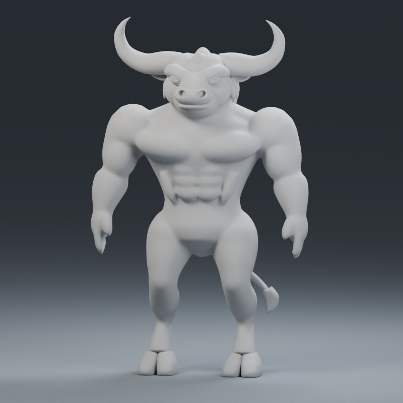

# PolyForge · Minotaur study

A runnable Godot character study of the far-right minotaur in the supplied lineup. The model opens in a neutral stance, uses one matte gray material, and has a 22-joint skeleton.



[Rear shape comparison](preview/minotaur-back.jpg) · [Step in place from behind](preview/minotaur-motion.mp4) · [Neutral turntable](preview/minotaur-turntable.mp4) · [Rigged 3D model](godot/minotaur.glb)

## Open the studio

Import `godot/project.godot` in Godot 4.3 and press **F6** with the studio scene open, or **F5** to launch the project. The model is included. Drag the viewport to orbit, scroll to zoom, and use the sliders for horn span, muzzle length, and chest depth. Select **Idle** or **Step in place** to play an animation, or **Neutral** to restore the original stance. **Save proportions** remembers the slider values for the next session on that computer.

The GLB also opens independently in Blender or another glTF viewer. It carries the neutral mesh, shape controls, and baked idle and step-in-place clips (the latter uses the animation key `Walk`). The Godot studio stores edits locally. To bake a different base model for distribution, edit the JSON recipe and rebuild it.

## How this reference is fitted

The anatomical interpretation of the supplied image is in `models/reference.json` and `models/minotaur.json`. The fitting tool uses the annotated horn windows to detect the visible tips and outside contours, calibrates their size from eye height above the ground, and solves for the corresponding catalog horn width and rise. The source image stays local. The exposed muzzle, torso, arms, hooves, and tail are shaped in the procedural builder. Hidden anatomy is estimated. The first prototype has one anatomical family; new subjects currently need a part recipe and visible landmarks.

With Python, NumPy, SciPy, and Pillow installed:

```sh
python tools/fit_reference.py path/to/lineup.png --output models/minotaur.json
```

## Generate the rig and previews

The generator was run with Blender 4.3.2, NumPy, and SciPy. The recipe selects the core parts and sets horn span and rise, shoulder width, chest depth, and muzzle length. The builder creates the anatomy, binds the skeleton, adds shape controls, and solves and bakes the gait. The two-second step cycle keeps each hoof fixed in world space for 60% of its cycle. Both feet briefly share the load as the pelvis shifts toward the next support. The ribs turn against the pelvis, followed by the arms, head and tail. The idle breath originates in the upper body.

```sh
blender -b --python-exit-code 1 -P tools/build.py
blender -b --python-exit-code 1 -P tools/render.py -- godot/minotaur.glb review --clip still
```

For the editable Blender scene, pass `-- --review review` to the build script. Render accepts `--clip turn` or `--clip walk` for PNG sequences. The review uses independent videos for the neutral orbit and the stationary step. The step preview uses `--azimuth 146` to show how the back and hips deform under load. The renderer uses 64 samples per motion frame. Supply `--oidn /path/to/oidnDenoise` to apply Open Image Denoise before the display transform. The preview images come from reimporting the exported GLB.

To check the imported sole contacts, run `godot --headless --editor --import --path godot`, then `godot --headless --path godot --script "$PWD/tools/tests/ground_contact.gd"` from the repository root. The check samples the soles through idle and both sides of the step, including between baked keyframes.

The design plan and research are in [PLAN.md](PLAN.md).
